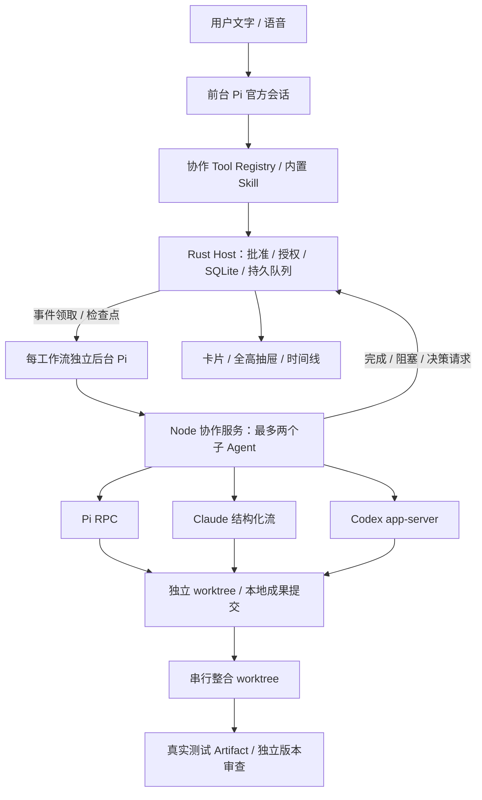

# 4B 多 Agent 协作：实现与验收

验收日期：2026-10-11。4B 保留未提交，等待用户 review。
4A 已提交并 push：`b2ab28e`，交付记录 `923af22`。

## 实现边界



- 主 Pi 决定工作项和角色；调度器只执行批准、依赖和资源检查，不另建 Agent Loop。
- 批准由原生客户端用户命令作出，绑定版本、Host SHA256 摘要和意图代际；
  Worker 没有批准接口。主 Pi 原生写入/脚本不能绕过活跃协作对目标仓库的门控。
- 默认两个子 Agent 执行槽；规划及审查也使用隔离工作区。依赖成果来自具体提交，
  多个不同依赖须先整合，不随机选一个作为基线。
- 已批准的本地提交仅保存独立工作区；不 push、不隐式修改用户当前分支。
  整合先保存待执行日志再 cherry-pick；冲突、崩溃窗口和历史改写要求核对，
  不盲目重复可能已生效的操作。
- 应用当前源分支由客户端单独预览并确认，Host 单次令牌绑定精确计划、
  ref/HEAD 和成果提交。仅允许干净源目录 fast-forward；变化基线、分叉、
  Git 在途操作均拒绝。失败/重启为 unknown，人工核对废止令牌后再申请。
  不声称能阻止外部 Git 进程在校验与执行之间修改仓库。
- Provider 权限逐次经 Host 策略；不启用跳过权限。Claude 不支持轮中 steer；
  三个 Provider 都不声称支持原地暂停。客户端暂停停止在途尝试，
  恢复重开计划门控，具体续接创建新尝试及工作区。
- 完成不等于验收：只读成果要求工作区干净且基线未变；verified 要有当前
  版本的真实测试 Artifact、独立审查和无未解决问题，后续修改使证据失效。
- 事件先持久化再通知 UI。每工作流后台 Pi 独立领取事件，不依赖语音会话；
  空队列不调用模型，Host 通过独占租约/检查点/消费序号防止重复协调。
  精确通知直接领取，不经额外 Session 查询；通信安全重试，工具和模型不重放。
- 旧意图成果和证据保留历史，但不能作为新代际验收。恢复只续排 Host 证明
  从未启动的队列；已发送启动请求或在途结果先核对，脏 worktree 保留。
  暂停/取消/待重批不自启。活跃协作 Session 不允许直接删除。

## 自动测试

| 边界           | 本轮证据                                                                                                      |
| -------------- | ------------------------------------------------------------------------------------------------------------- |
| TS / Rust 契约 | 共享计划 Fixture；角色/Provider 分离；拒绝环、重复身份、未知依赖、伪造批准和非法基线                          |
| SQLite / Host  | 精确批准、范围内修订、实质变化撤销批准、恢复 unknown、事件游标、真实 Artifact 校验；应用令牌单次使用与核对    |
| 进程           | JSONL 分帧、有界输出、异常退出、PTY、取消进程树、Provider 假流和权限回执                                      |
| 调度           | 两个槽、依赖和重复派单、串行权限、取消排队、健康提示不重启、只读基线校验                                      |
| Git            | 脏源目录提示、显式基线、隔离提交、重启归属、冲突保留/续接、整合历史改写拒绝；源分支干净 fast-forward          |
| 合成闭环       | Fake Provider / Host + 真实 Git / 测试运行器：规划、两路实施、串行整合、`node check.mjs`、独立审查            |
| 监督           | 独占租约/幂等领取和提交、空队列不调用模型、通信重试不重放模型、失败不前移游标、三轮无进展、停止播报不停止协作 |
| 托管           | 精确 grant、代理/真人决策分开、结构化澄清、越界和旧意图拒绝、批准/执行状态分开查询                            |
| 受限测试       | macOS 真进程验证工作区写入允许、工作区外写入/密钥读取/网络拒绝                                                |
| UI 状态        | 迟到快照不能覆盖新版本或事件序号；不从模型文字推断成功                                                        |
| 既有功能       | 调研、语音、文字输入、播放、Session 自动测试回归                                                              |

合成闭环并非真实模型决定工作流，也未替代原生窗口与 Host 的完整手工测试。
三轮返工上限与拒绝伪造版本证据由 Rust 测试分别覆盖，不称作一次真实 CLI 闭环。

## 真实 CLI 冒烟

三个已认证 CLI 的合成文件写入测试均通过，写入均观察到权限请求。
Pi/Claude 读取已有成功记录；本次另对 Codex 的读取证据进行复核，
不能用仅返回正确暗号但没有工具活动的结果证明真实读取。

| Provider | 写入权限请求 | 工具活动 | 会话标识 |
| -------- | ------------ | -------- | -------- |
| Pi       | 3            | 3        | 已获得   |
| Claude   | 2            | 3        | 已获得   |
| Codex    | 2            | 2        | 已获得   |

使用本地认证与模型配置，Pi 使用已有 DeepSeek 配置，不使用慢速
`gpt-5.6-sol`。脚本只操作临时合成文件，测试完清理，不读取用户项目。
复现可能产生模型费用：

```sh
cd packages/agent-worker
DISABLE_AUTOUPDATER=1 node --experimental-strip-types scripts/smoke-coding.ts pi --write
DISABLE_AUTOUPDATER=1 node --experimental-strip-types scripts/smoke-coding.ts claude --write
DISABLE_AUTOUPDATER=1 node --experimental-strip-types scripts/smoke-coding.ts codex --write
```

去掉 `--write` 验证读取。上述冒烟不证明多模型协作的任务质量，
也不证明真实轮中 steer、重启恢复和完整原生监督已经验收。

### 真实 Host + 多 Provider 验收脚本

新增 `crates/host/examples/workflow_bridge.rs` 和
`packages/agent-worker/scripts/smoke-workflow.ts`，以真实 Rust Host/SQLite、
真实 Git/测试运行器及 Pi/Claude CLI 操作临时合成仓库。用户批准由测试桥
独立模拟，不作为产品 Worker 可自批准的接口；不是主 Pi 自主编排验收。

```sh
cargo build -p semi-os-host --example workflow_bridge
cd packages/agent-worker
DISABLE_AUTOUPDATER=1 node --experimental-strip-types scripts/smoke-workflow.ts
```

- 首次执行完成规划、两路实施、整合、测试及独立审查，但脚本漏传整合
  `commits` 字段，最终证据未能保存；已修正，不记录为通过。
- 修正后一次执行到最终审查时 Claude 返回失败终态；当时提示过于笼统，
  无法确认原因。Adapter 已补脱敏类别和回归测试，不输出原始错误。
- 再次执行完成规划、Pi/Claude 两路实施、串行整合及真实测试，
  但最终 Claude 审查进程无法启动。独立只读探测也失败，无权限/会话事件。
  当时 `command -v claude` 无结果，直接 `spawn("claude", ["--version"])`
  返回 `ENOENT`。后续核对发现 2026-10-11 19:44（UTC+8）的 npm 更新
  从 `2.1.261` 到 `2.1.296` 失败，原安装及命令入口被移动到临时位置。
  经用户授权已恢复原版包目录和 `/opt/homebrew/bin/claude`，
  `claude --version` 返回 `2.1.261`，`claude auth status --json` 确认已登录；
  未改动用户配置和认证，未完成的新包单独保留。此记录不能解释前一次模型失败。
- 恢复 Claude 后本次完整重跑通过：规划、Pi/Claude 两路实施、测试、
  串行整合、Claude 独立审查，5 次执行尝试、18 次权限请求，
  `node check.mjs` 退出码 0；真实 Host 将版本绑定证据保存到 SQLite。
  批准前实施被拒绝，两个实施任务使用不同 worktree，最终源仓库 HEAD
  及工作区保持不变。临时仓库和子进程已清理。本次进程临时关闭 Claude
  自动更新，不修改持久配置、认证或用户仓库。

### 本次 Codex 复核

- 写入再次通过：2 次权限请求、2 次工具活动、有效会话及实际文件变化。
- 原读取提示要求不存在的独立 read 工具，一次超时，随后一次只答对暗号、
  没有工具活动；两者都不能作为真实读取验收。
- 改为明确 `cat fixture.txt` 后，观察到工具及权限请求，但脚本最初拒绝
  CLI 的 shell 包装。脚本现仅允许合成目录内精确的裸命令或该命令的 shell
  包装，不放行其他 shell 动作；真实读取还必须观察到工具活动。
  修正后读取复测通过：1 次权限请求、1 次工具活动、有效会话，
  文件内容未变。这个许可来自独立冒烟回调，而不是产品 Host 策略。
- 上述原产品缺口在后台优化中已修复：Host 解析简单只读命令、真实路径、
  危险选项及 shell 包装；Git status 关闭 fsmonitor、diff 关闭外部程序。
  未知命令及无法证明边界的写操作仍需真人。Host 白名单/越界回归通过，
  但尚未重跑完整原生 Codex 规划/审查，不以独立冒烟替代该项验收。

## 真实后台 Pi 自主闭环

2026-10-11，以下脚本通过真实 Pi SDK 协调会话、真实 Rust Host/SQLite、
真实 Pi/Claude CLI、独立 Git worktree 和受限测试运行器：

```sh
cargo build -p semi-os-host --example workflow_bridge
cd packages/agent-worker
node --env-file=../../.env --experimental-strip-types scripts/smoke-background.ts
```

结果：11 个事件驱动协调轮次，4 次派单、1 次测试、1 次整合结果保存；
最终 `verified`，测试退出码 0、独立审查绑定整合版本，源仓库 HEAD/工作区未变。
主 Pi 不占两个子 Agent 执行槽。临时仓库和子进程已清理。

脚本预先定义总计划并通过验收桥模拟一次真人批准，之后只观察，不为 Pi
选择派单、整合、测试或审查步骤。这证明已批准任务的自主推进，不证明初始
计划由 Pi 动态生成、真实返工、子计划审批或原生客户端批准体验。

### Claude 结构化问答

```sh
cd packages/agent-worker
node --experimental-strip-types scripts/smoke-claude-decision.ts
```

真实 `AskUserQuestion` 产生 1 次结构化请求，回调答案后完成；未模拟键盘批准。
此探测验证 Provider 回调，Host 代理决策另由确定性测试覆盖；
尚未验证真实 `ExitPlanMode` 兼容，保留计划产出、主 Pi 审查、明确续接实施流程。
所有 Claude 子进程禁自动更新，不改安装、认证或用户持久配置。

## 云端语音调研回归

```sh
DISABLE_AUTOUPDATER=1 node --env-file=.env --experimental-strip-types scripts/research-live.ts
```

本次使用云端生成的合成语音，经过 Fun-ASR、主 Pi SDK、Playwright、
Rust Host/SQLite 及 CosyVoice 输出，后端链路通过：

- 采集 Playwright / Vitest 两个真实网站，2 个来源正文 Artifact 持久化；
  2 条结论均关联有效来源及实际引用，3 条失败来源记录保留。
- 生成 9 句音频（4 句阶段提示、5 句回答），未收到 `voice.error`。
  输出是 22050Hz 单声道 s16le PCM；修正测试脚本保存为 `.pcm`，
  不再错误标记为 `.mp3`。
- 从启动该轮语音提交链路到后端完成共 59.358 秒；
  STT 总计 4.679 秒、首个答案段就绪 31.804 秒，
  第一答案段 TTS 首包 1.865 秒。首段指标包含工具执行，
  不是纯模型推理延迟，也不是用户实际听到声音的耗时。
- 结果保存在 Git 忽略的 `output/research-live-1791720077246/`。
  只读取了网站首页片段，不称作完整文档阅读或事实正确性的证明。

这是单次真实云端样本，没有 P50/P95；不证明真人 STT 准确率、
原生麦克风首字、扬声器实际播放或插话动画同步。

## 浏览器与检查

浏览器使用真实 React 组件和合成 Tauri IPC，不冒充真实后台。
1512×788 检查计划、范围、授权、依赖、修改输入和按钮布局。
验证修改请求携带精确版本/摘要/理由；批准和控制操作沿各自命令发送。
截图为本地 `/tmp/semi-os-4b-approval.png`，不提交测试截图。
另以实际 `WorkflowPanel` 验证应用预览及确认载荷、Claude 不支持的追加指令入口隐藏；
760×740 无水平溢出，截图 `/tmp/semi-os-4b-application.png` 已检查。
这些均为浏览器 IPC Fixture，不等同于原生 Host 实际应用验收。

本轮后台托管补充验证使用实际 `WorkflowPanel` 和合成 Tauri IPC：
1200×800 展示 `needs_user` 澄清并提交答案，随后刷新为可继续状态，
点击“已核对，继续后台协调”；两次调用分别为
`answer_workflow_question` 和 `control_workflow`，载荷绑定精确
`workflowId/requestId/version/digest`。760×740 检查无水平溢出、无
Vite 错误覆盖层和控制台错误。截图保存在 `/tmp/semi-os-4b-background-question.png`
与 `/tmp/semi-os-4b-background-resume.png`，不提交测试截图。

浏览器插件在本环境不可用，本次按前端测试规范使用仓库已安装的 Playwright
进行回退验证；该结果只证明客户端结构化状态和 IPC 载荷，不证明原生窗口、
托盘或真实 Host 回执。

```sh
pnpm check
cargo fmt --all -- --check
git diff --check
```

最终检查（2026-10-11）通过：JavaScript 169 个测试、Rust 55 个测试，
合计 224 个测试；类型检查、JavaScript lint、Clippy、JavaScript 构建、
Rust 构建、`cargo fmt --all -- --check` 和 `git diff --check` 均通过。
构建仍有 Vite 单个大 chunk 的既有提示，不影响通过结果。

## Review 入口

| 文件                                                                    | 重点                                           |
| ----------------------------------------------------------------------- | ---------------------------------------------- |
| `packages/protocol/src/workflow.ts` / `crates/protocol/src/workflow.rs` | 任务图和跨进程校验                             |
| `crates/storage/src/workflow.rs`                                        | 精确批准、快照、监督队列、版本证据和恢复       |
| `crates/storage/src/workflow_background.rs`                             | grant、事件领取/检查点、决策、无进展及状态查询 |
| `crates/host/src/workflow_policy.rs`                                    | 只读命令、工作区边界、自动授权与真人确认       |
| `crates/host/src/workflow.rs` / Tauri `main.rs`                         | Host 摘要、用户命令、原生工具边界              |
| `packages/agent-worker/src/collaboration/service.ts`                    | 并发、权限、依赖、健康、取消、续接             |
| `collaboration/*-provider.ts` / `process.ts`                            | CLI 协议与进程生命周期                         |
| `collaboration/workspaces.ts`                                           | 归属、Git 提交、串行整合和日志                 |
| `collaboration/workflow-tools.ts` / 内置 collaboration Skill            | 主 Pi 的官方工具扩展入口                       |
| `collaboration/coordinator.ts` / `test-runner.ts`                       | 独立 Pi、安全通信重试、macOS 限制测试运行器    |
| `packages/agent-worker/src/worker-service.ts`                           | 前台/后台生命周期隔离、精确事件唤醒            |
| `apps/desktop/src/ui/WorkflowPanel.tsx`                                 | 计划决策、工位、依赖、时间线、Diff 与测试      |

## 尚待验收 / 未完成

- 完整原生链路：主 Pi、真实 Rust Host、两个不同的真实子 Provider，
  同仓库并行、整合、测试、独立审查，以及期间继续文字/语音对话。
- 真实后台 Pi 已自主推进合成闭环；总计划仍为预定义，不证明动态初始分工、
  真正自主返工及真实子计划审批。Codex 权限分类已修复并自动回归，完整原生
  Codex 只读规划/审查仍需验证。
- 窗口关闭至托盘、显式退出、Worker 崩溃/断网/权限等待恢复均有实现和
  确定性覆盖，但尚未完成同一真实长任务的原生故障注入验收。
- 通知为客户端及托盘标题/提示，尚未接入系统通知中心。自然语言目标变化
  依赖前台调用控制工具；客户端修改入口先由 Host 撤销旧 grant。
- 原生手测：权限确认、改目标、追加指令、重启 unknown 核对、Provider 续接；
  自动契约测试已覆盖，但不能代替真实进程与窗口体验。
- 客户端“应用到当前分支”独立确认及后端校验已实现，自动测试和浏览器
  IPC 验证通过；实际原生点击、Host/Worker 回执及重启核对仍需手测。
- `munder-difflin` 未在本轮做源码核对，不把其 README 或用户参考当实现依据。

`tasks.md` 中 P4B.6 / O1–O4 已完成实现及自动验证，P4B.8 / O5 保持部分完成，
不以自动测试通过宣布完整原生产品验收。
