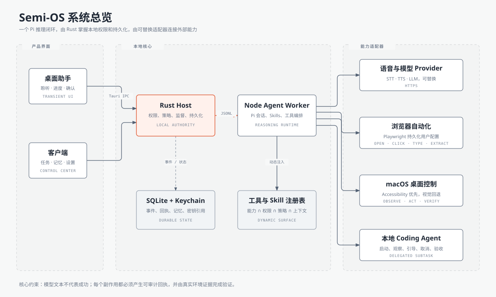
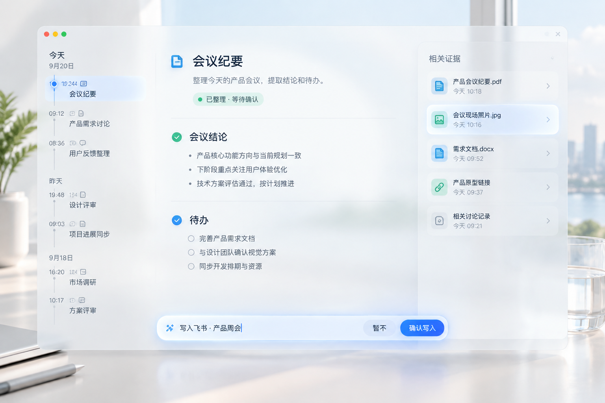
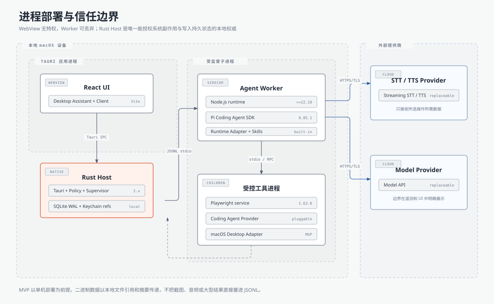
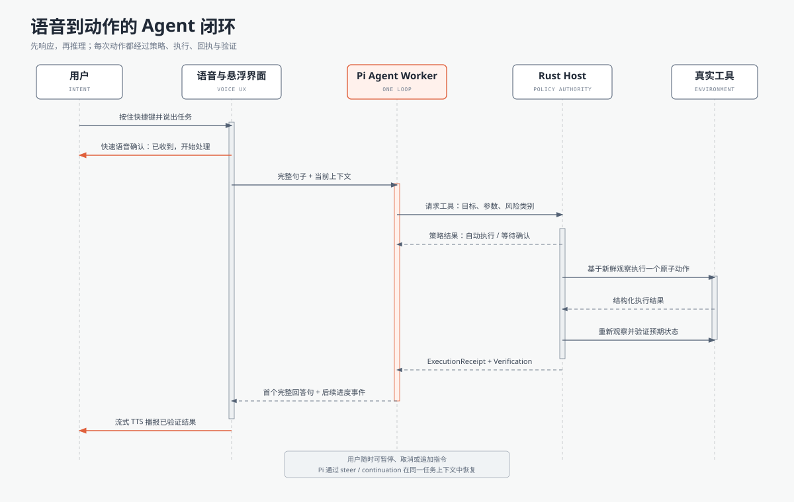
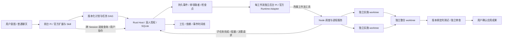
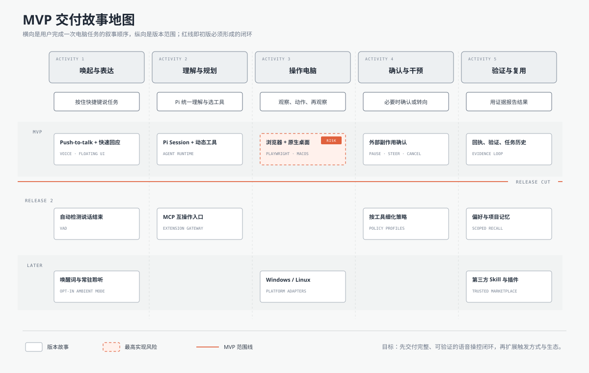

# Semi-OS Detailed Design

> Version: v0.1
>
> Date: 2026-09-15
>
> Stage: architecture baseline, before implementation
>
> Audience: product owner, desktop engineers, agent-runtime engineers and contributors

## Executive summary

Semi-OS is a local-first, voice-first desktop agent. Its core promise is not
“talk to an AI”, but “speak an intention and let the system safely operate the
computer until the result is verified”.

The MVP supports three representative task families:

1. Research work: search multiple websites, collect relevant material, synthesize
   the findings and report the result by voice.
2. Coding work: delegate a repository task to a local coding agent, monitor its
   progress, interrupt or steer it, and report the verified outcome.
3. General computer work: open an application, operate a macOS application or
   use Lark CLI for a supported operation. WeChat-specific automation is
   deferred until the generic application path is reliable.

The proposed runtime is `Tauri + React + Rust Host + supervised Node Agent
Worker`. Pi is embedded through an adapter and remains the unified reasoning
loop. Rust owns privileged operating-system access and durable local state.
Tools are exposed dynamically according to platform capability, user policy,
task context and current permission state.

### Architecture hardening baseline

The protocol schema at `schemas/protocol.schema.json` is the single source of
truth for the Host/Worker boundary. TypeScript and Rust consumers validate the
envelope and kind-specific payload fields before dispatch. TypeScript
discriminated unions and Rust DTOs are generated from that schema; Worker
request dispatch uses an exhaustive switch. Unknown message kinds,
malformed payloads and unsupported protocol versions are explicit boundary
errors, not best-effort fallbacks.

Quality checks are intentionally split into `lint`, `format:check`, `typecheck`,
`test` and `build`, with Rust checks and `git diff --check` running alongside
them. Existing legacy formatting is tracked in `.prettier-baseline` so the
baseline can become stricter without a history-wide formatting diff.

Host decomposition is incremental: pure routers and a structured `HostError`
are extracted while Tauri window, tray and lifecycle assembly remains in the
entrypoint. Durable Storage APIs expose domain DTOs; JSON remains an internal
representation for compatibility migrations. RPC retries reuse a request
identity and payload digest, and an unknown side-effect result must be
reconciled before retry.

Workflow queries use `WorkflowSnapshotDto`, `WorkflowNotification`,
`WorkflowBackground` and related typed records at the Storage/Host/UI boundary.
The compatibility layer may still decode historical JSON snapshots and accept
legacy Worker operation results, but it must decode them before UI emission,
notification routing or run authorization. This keeps old migrations stable
without allowing arbitrary database JSON to become a client contract.

Read-only implementations live in `workflow_queries.rs`; raw JSON queries are
crate-private, DTOs live in `workflow_dto.rs`, and state-machine tests live in
`workflow_tests.rs`. Mutation results now return `WorkflowSnapshotDto` inside
Storage, while Host/IPC serializes the unchanged legacy wire shape. Coordinator
claims use an explicit `WorkflowClaimResult` discriminator, and checkpoints are
validated before a lease is acquired. Delegated decision lookups return
`WorkflowDecisionResult` rather than an arbitrary JSON value; decision values
have explicit authority, reason, approval and question-answer fields.
Startup recovery validates snapshots across all sessions before notifying the
Worker; corrupt records produce an explicit recovery error instead of silently
dropping a session. Decision registration and answers accept typed
`WorkflowDecisionInput` and `WorkflowDecisionValue`; their decision kind is
still validated by the domain layer.

Host workflow dispatch decodes legacy `{ operationId, operation, value }`
messages into operation-specific DTOs before accessing Storage. Unknown
operations, missing fields and invalid field types fail before mutation;
optional find filters default only when omitted, not when malformed. This is
an internal domain projection, not an alternative wire schema: the generated
protocol validator remains the process-boundary authority. Existing JSON
entrypoints remain compatibility adapters, and typed plans reach persistence
without an intermediate JSON round trip.

P8.5 has inbound Host RPC receipts (`rpc.rs`, migration `0010`):
durable workflow mutations replay saved results for identical requests and
reject digest conflicts. Live lease and authorization checks are deliberately
re-evaluated rather than replayed. The outbound ledger (migration `0011`)
records identity, digest and transport state through a separate Storage
connection, avoiding reentrant business-Storage locks. It stores neither raw
request payloads nor secrets; realtime `voice.*` requests are excluded.
Queued duplicates are suppressed, failed enqueue releases the unsent receipt,
and `sending` is persisted before the first pipe byte. Interrupted sends enter
reconciliation; a reconnect cannot blindly replay them. Unsent requests may be
queued again with the same identity. ACK pairing is checked, and a transport
ACK never proves business completion. Explicit Host reconciliation requires
evidence; it does not fabricate a completed business result.

The first Host decomposition slices isolate lifecycle, voice and research
routing from the Tauri shell. `LifecycleCommand` and `route_lifecycle` can be
tested without a WebView, Worker or database. Voice event application and
research event classification follow the same rule: stale identities,
cross-session events and malformed payloads are rejected before the desktop
snapshot or durable state is changed. Research and workflow persistence,
reply construction and effects are handled in the Host modules; thin desktop
routers apply those effects and wire UI delivery. The Tauri entrypoint keeps
command registration, dependency injection and window/tray lifecycle assembly.
`HostError::ui_message` keeps internal storage and runtime details out of UI
responses, with string compatibility retained at existing IPC entrypoints.

The three MVP scenario families are not a mandatory technical sequence. They can
be developed in parallel because they share the same voice pipeline, Pi session,
TaskRun lifecycle, tool contract, event stream and evidence model. The main
scenario-specific adapters are browser research, local coding-agent terminal
sessions and native application/Lark operations.



## 1. Product boundaries

### 1.1 What the MVP must prove

The first release succeeds when a user can:

- hold a shortcut, speak a task and hear the first useful response quickly;
- see a minimal floating assistant while the task is active;
- ask for a multi-site research report and hear a sourced synthesis;
- describe a requirement in the current project and have a local coding agent
  work on it through a PTY-like interaction;
- let the agent use browser, native desktop, Lark CLI and coding tools;
- interrupt with a new instruction without losing the task context;
- approve or reject external side effects;
- recover from ordinary process/network failures;
- receive a voice summary grounded in execution evidence;
- benefit from remembered preferences and prior task context.

### 1.2 What the MVP is not

- It is not a fully autonomous background operator.
- It is not a universal cross-platform automation engine on day one.
- It is not a plugin marketplace.
- It does not promise WeChat automation in the first release.
- It does not treat screenshots as the only desktop control surface.
- It does not expose raw chain-of-thought or every internal tool call.
- It does not claim success from an assistant sentence without verification.

### 1.3 Experience surfaces

The experience intentionally has two surfaces:

- **Desktop assistant:** transient, ambient and voice-first. It appears while
  listening, working or waiting for confirmation. Its native window is
  transparent, shadowless, nonfocusing and mouse-passthrough. Only the halo
  and particles are visible; confirmations and text live in the client.
- **Client:** persistent control center for conversation, task history, memory,
  skills, permissions and settings.




The prototype uses an earlier temporary label. `Semi-OS` is the repository and
working product name; visual identity and micro-interactions remain adjustable.

### 1.4 Interaction and task model

The MVP does not require a separate intent classifier to decide whether a
request is “simple” or “complex”. Every user turn enters the same Pi session.
The runtime observes whether the Agent actually requests execution tools:

- no execution tool: conversational response, with memory recall treated as
  context retrieval rather than task execution;
- one or more execution tools: create or continue a visible `TaskRun`, emit
  progress milestones and collect execution evidence.

The Agent may decide that a user interruption is a steering instruction for the
active task, a request to pause or cancel, or a new task. Semi-OS preserves the
same session and task evidence so this decision does not depend on hard-coded
phrase matching.

The desktop assistant can use expressive visual effects without making the
animation a semantic state machine in the MVP. Mouse-following motion, a
particle field and speech-synchronized waveform motion are presentation
effects. The client still shows a clear, low-complexity task timeline with
current step, recent action, waiting reason and final result.

### 1.5 MVP acceptance scenarios

#### Scenario A: multi-site research and voice briefing

Input: the user asks Semi-OS to research a topic or question.

Expected behavior:

1. begin with a meaningful stage prompt when execution starts, without a fixed acknowledgement;
2. search multiple relevant websites using the browser tool set;
3. record source URLs, extracted facts and failed or blocked sources;
4. synthesize the findings, distinguish facts from uncertainty and cite the
   source list in the client;
5. begin TTS with the first complete summary sentence and finish with a short
   voice report;
6. persist a task summary and useful, properly scoped memory candidates.

Acceptance evidence: the task timeline shows sources visited, extracted
artifacts, synthesis and final verification. A user can inspect the source
list and replay the concise result without relying on model prose alone.

#### Scenario B: delegate work to a local coding agent

Input: the user describes a requirement for the currently open or selected
project.

Expected behavior:

1. identify the repository and constraints from the active workspace and
   relevant memory;
2. start a registered local provider such as Pi, Claude Code or Codex through a
   common PTY-like terminal adapter;
3. stream useful milestones, output and changed-file summaries to the client;
4. allow the user to speak a steering instruction, pause or cancel;
5. collect the child agent exit state, diff, diagnostics and test results;
6. report the verified outcome by voice, including incomplete or unknown work.

Acceptance evidence: the task has a child-agent receipt, repository identity,
changed-file summary and verification artifacts. A worker restart does not
replay a completed child-agent action.

The common terminal layer handles process lifecycle, input, output streaming,
resize and cancellation. Provider adapters handle the differences that matter
after the process starts: startup arguments, authentication state, interactive
permission prompts, output/event parsing, resume semantics and result
collection. These differences should not force separate task models.

#### Scenario C: generic application operation

Input: the user asks Semi-OS to open an application, operate a supported
desktop surface or perform a Lark CLI operation.

Expected behavior:

1. launch or focus the target application;
2. observe the current application state;
3. perform one bounded operation at a time and observe again;
4. show clear progress in the task timeline;
5. speak the result or explain the exact point where user input is required.

WeChat is intentionally not an MVP acceptance blocker. It can later reuse the
generic desktop path or gain a dedicated adapter after the generic path has
proven reliable.

#### Shared acceptance rules

- conversational turns remain fast and do not create a visible task unless an
  execution tool is requested;
- memory retrieval alone does not count as task complexity;
- task progress is derived from domain events and receipts, not parsed from
  assistant prose;
- every execution scenario has meaningful spoken progress and a final voice
  response;
- the client allows manual personality editing and manual user-preference
  entry;
- an Agent may append or revise only memories it created, while user-authored
  preferences and memories are read-only to the Agent.

## 2. Architecture principles

### 2.1 Local-first authority

Task history, memory, policy, receipts and user settings live locally by
default. Cloud STT, TTS and LLM providers receive only the data required for the
selected operation. Provider boundaries must be explicit in telemetry and UI.

### 2.2 One reasoning loop

All meaningful user tasks enter the Pi-backed agent session. Deterministic code
may normalize input, enforce policy and execute tools, but it must not create a
second hidden “simple agent” that bypasses Pi. This keeps tool investment,
steering, memory injection and task history relevant to every workflow.

### 2.3 Privilege separation

The webview cannot directly run shell commands, access secrets, write SQLite or
drive macOS accessibility APIs. It sends typed commands to the Rust host. The
Node worker cannot grant itself capabilities; privileged requests return to
Rust for policy enforcement and execution.

### 2.4 Evidence before completion

Each action returns an `ExecutionReceipt`. The task finalizer requires
appropriate evidence for the task class:

- browser: URL/DOM state, extracted content, download or network result;
- desktop: focused window, accessibility state, screenshot diff or app state;
- coding: exit status, changed files, diagnostics and tests;
- external side effect: provider identifier, remote object ID or reconciliation.

### 2.5 Replaceable edges

Volatile dependencies sit behind interfaces:

- `AgentRuntimeAdapter` for Pi;
- `SpeechToTextProvider` and `TextToSpeechProvider`;
- `BrowserAutomationProvider`;
- `DesktopAutomationProvider`;
- `EmbeddingProvider` and `MemoryStore`;
- future `McpGateway`.

## 3. Process architecture



### 3.1 React UI

Responsibilities:

- render desktop assistant and client windows;
- capture push-to-talk intent and display live state;
- submit user decisions for confirmation requests;
- render domain events, not infer state from assistant prose;
- never hold provider secrets or execute privileged actions.

Recommended frontend stack:

- React + TypeScript + Vite;
- a small state machine/store for UI projections;
- Tauri event/command APIs;
- Canvas/WebGL only for the dynamic assistant core, isolated from business UI.

### 3.2 Rust host

Rust is the local authority and supervisor:

- app lifecycle, tray, windows and global shortcut;
- microphone and macOS permission checks;
- Keychain-backed secret references;
- SQLite connection, migrations and transaction boundaries;
- native desktop observation/action adapters;
- policy enforcement for privileged tool calls;
- spawn, monitor and restart the Node worker;
- map worker events onto Tauri events;
- redact and persist structured telemetry.

### 3.3 Node agent worker

The worker owns reasoning-oriented orchestration:

- instantiate the Pi session through `AgentRuntimeAdapter`;
- stream model events and translate them into domain events;
- build the dynamic tool set for each task/turn;
- match built-in skills and inject selected resources;
- coordinate STT/TTS providers;
- manage pause, abort, steer, follow-up and threshold-based compaction;
- call Rust-owned privileged tools over a narrow RPC boundary;
- supervise browser and coding-agent subprocesses.

The worker is disposable. After restart, it rebuilds state from SQLite,
persisted Pi session data and task checkpoints.

### 3.4 Communication

Use three typed channels:

| Channel           | Transport                  | Purpose                                           |
| ----------------- | -------------------------- | ------------------------------------------------- |
| React ↔ Rust      | Tauri commands/events      | UI intent and domain event stream                 |
| Rust ↔ Node       | local JSONL RPC over stdio | supervised control and privileged tool bridge     |
| Node ↔ child tool | process-specific stdio/RPC | Playwright service, coding agent, future adapters |

JSONL records carry `protocolVersion`, `requestId`, `taskId`, `kind`, `payload`
and optional `traceId`. Unknown message versions fail closed. Large binary data
is passed by local file reference plus digest, not embedded in JSON.

## 4. Agent runtime and control loop

The current verified Pi package is `@earendil-works/pi-coding-agent`. Its SDK
supports embedded sessions, event subscription, `steer`, `followUp`, `abort`,
dynamic tool replacement and extensions. Semi-OS should use the SDK first and
keep Pi behind an adapter rather than editing Pi internals immediately.



### 4.1 Adapter contract

```ts
interface AgentRuntimeAdapter {
  startSession(input: StartSessionInput): Promise<AgentSessionHandle>;
  prompt(input: AgentPrompt): Promise<void>;
  steer(input: AgentSteering): Promise<void>;
  followUp(input: AgentFollowUp): Promise<void>;
  pause(taskId: string): Promise<PauseResult>;
  abort(taskId: string): Promise<void>;
  replaceTools(tools: AgentToolDescriptor[]): Promise<void>;
  subscribe(listener: (event: AgentRuntimeEvent) => void): Unsubscribe;
  checkpoint(): Promise<AgentCheckpoint>;
  dispose(): Promise<void>;
}
```

`pause` is a Semi-OS semantic operation. Depending on the active phase it may:

- stop audio/TTS immediately;
- abort an in-flight model request;
- request cooperative cancellation from the active tool;
- preserve the last completed receipt and Pi session branch;
- transition the task to `paused`;
- on resume, inject a short continuation context and any new user instruction.

### 4.2 Dynamic tool injection

The available tool set is the intersection of:

```text
built-in catalog
∩ platform support
∩ granted OS permissions
∩ user policy
∩ task workspace
∩ runtime health
∩ active skill requirements
```

Pi built-ins such as file reading/writing and shell execution should not be
duplicated without a policy reason. Semi-OS adds tools Pi does not natively own:

- browser: `browser_open`, `browser_click`, `browser_type`, `browser_extract`;
- desktop: `desktop_observe`, `desktop_click`, `desktop_type`, `desktop_key`,
  `desktop_scroll`, `desktop_focus_window`, `desktop_launch_app`;
- confirmation: internal policy-controlled approval requests;
- coding delegation: start/observe/steer/cancel a local coding-agent task;
- memory: scoped recall, automatic memory writes and memory proposals where a
  later policy requires review.

### 4.3 Skills

A Skill is declarative guidance plus optional scripts/resources. MVP Skills are
built in and signed with the app release. Selection uses:

1. deterministic candidate matching from intent, app, domain and tool needs;
2. injection of a compact candidate list;
3. final selection by the agent;
4. loading only the selected Skill’s detailed instructions and resources.

This avoids injecting the complete skill library into every prompt. Pi’s native
resource loader and extension hooks are preferred; a Semi-OS `SkillRegistry`
adds metadata, trust and compatibility rules around them.

## 5. Voice architecture

### 5.1 Pipeline

```text
push-to-talk
→ capture/denoise
→ streaming STT
→ final utterance
→ Pi prompt
→ first complete answer sentence
→ streaming TTS
→ continued task progress
```

MVP waits for the first complete user sentence before sending the task to the
agent. Automatic voice-activity detection and wake word remain extension
branches.

### 5.2 Latency strategy

Latency is not dominated by Pi alone. Measure separate budgets:

| Segment                                    | Target experience                                     |
| ------------------------------------------ | ----------------------------------------------------- |
| Hotkey to listening indicator              | effectively immediate                                 |
| Speech end to final transcription          | measure provider finalization separately              |
| Plan/progress                              | meaningful stage events, no universal acknowledgement |
| First complete assistant sentence to audio | begin TTS immediately                                 |
| Tool progress                              | emit structured milestones, not silent waiting        |

No fixed acknowledgement is generated for every input. TTS uses sentence
buffering for a short spoken summary; the full Markdown report remains separate.
The assistant WebView owns one capture/player controller. Rust relays current
conversation snapshots and stores final messages, not per-frame playback events.
Validated word timestamps advance text using actual playback position; without
timestamps, reveal the sentence only when playback starts. Buffering, failures
and interruption must not pretend that audio has played.

客户端提供多行文字输入，Enter 发送、Shift+Enter 换行；输入法选词不发送。
文字只跳过采集和 STT，经 Rust `submit_text_message` 定向转发到助手 WebView
的唯一控制器，再以 `voice.text.submit` 进入已有 VoiceLoop。最终文本之后
与语音共用 Pi Session、工具策略/确认、句子 TTS、Markdown 同步和持久化。
客户端不创建第二个 VoiceClient/播放器；麦克风关闭、授权拒绝或未处理
均不阻塞文字请求。后台预热失败不得覆盖正在运行的文字轮次。
发送新文字立即停止旧播报并关闭录音门控，不额外提交被替换的录音。
Host 回执确认请求已交给 Worker 传输后才清空未编辑的草稿；模型完成
不是发送成功的前提。失败保留草稿，接收结果未知时提示核对、不自动重发。
消息上限跨 JS/Rust 按 64000 UTF-16 单元统一校验；历史按时间正序展示，
靠近底部时跟随新内容，向上阅读时不强行滚动。

客户端 Session 不等同于单轮输入或 TaskRun。Host 的 SQLite 保存会话列表、
空会话及唯一 active 选择；普通文字/语音只追加轮次，手动新建才增加会话。
新建前弹窗命名；右键已有条目可重命名或确认删除。名称经 Host 校验并保存，
不会被消息改写。删除当前会话经过同一停止/切换握手，后继选择与聊天归档删除
原子提交；删除最后一个会话留下新的空白会话。Worker 接收有界的
`voice.session.dispose` 清理该会话 Pi 上下文，独立任务证据及浏览器 Profile 保留。
迁移将旧归档归属统一映射到默认会话，保留原始运行身份，不恢复旧 Pi 上下文。
切换意图经过助手唯一控制器：停止本地录音/播放、排队暂停旧任务，
Host 校验仍有效的切换回执后事务更新 active，客户端随后允许新输入。
Node Worker 按 sessionId 懒加载并复用独立 VoiceLoop/Pi Adapter；
只发送当前会话事件，不自建 Agent Loop。独立上下文限于同一 Worker 生命周期，
跨重启只恢复列表、选择与文字归档，Pi Checkpoint 恢复仍待后续实现。

Capture uses mono AudioWorklet frames, continuous cross-frame resampling to
16 kHz PCM16, and a stop/flush handshake before committing input. STT receives
frames during capture; interim text only updates the client. Only the final
transcript reaches Pi. Numeric diagnostics report actual sample rate, RMS,
peak, silence and clipping without storing microphone audio.
语音启用且授权后，默认预热麦克风轨道、独立采集 AudioContext 与 Worklet。
设备生命周期与录音轮次分离；空闲门控关闭，采样在 Worklet 内立即丢弃，
无按键前缓存、不保存、不上传。客户端可关闭预热；系统麦克风指示持续
出现是常驻设备的预期行为。关闭语音、退出或设备失效时释放设备。
按键同步打开就绪设备的门控，松键关闭并冲刷尾部；网络/Host 握手不阻塞
本地采集。每轮独立 token、PCM 缓冲与序号，上一轮云端提交未完成时
下一轮仍可采集。仅本地尾音冲刷串行；Worker start/append/commit 保序。
重复松键共用停止操作。回调同时校验节点及 token，旧采样和旧 flush
不能进入新轮次。设备切换重建，页面恢复时恢复音频时钟；尚未就绪时
松键不会在释放后补录。无采样、全静音、服务失败分别反馈。
权限弹窗不阻塞快捷键监听安装；首次授权期间不承诺即时首字采集。

The current application default is `fun-asr-realtime`, selected for user
evaluation after recognition-quality feedback. Set `SEMI_OS_STT_PROVIDER=qwen`
to restore Qwen. Each mode retains provider-specific parameters; Qwen inline
hotwords are not passed to Fun-ASR. This is not a claim of measured superiority
on real microphone input.

TTS transports PCM16 chunks. The current native compatibility output collects
one completed sentence, wraps it in WAV and plays through HTMLAudioElement
without WebAudio routing; the user confirmed this output is audible.
PCM16 预计算 20 ms RMS 包络，按媒体 currentTime 在本地 rAF 读取。
快速响应、缓慢回落；缓冲、暂停、失败和取消归零。Three.js 每帧读取 ref，
驱动内层细颤、外环小幅呼吸、粒子重音传播，不逐帧更新 React、写数据库
或跨窗口传递振幅。减少动态效果时关闭声振；无包络仅保留待机运动。
The optional provider transport preparation overlaps the WebSocket handshake
with recording, sends no synthesis request and expires after 15 seconds.
Cancellation releases an unclaimed connection. The first sentence claims it
once; later sentences use independent connections. The Worker records model
first delta, first complete spoken sentence, TTS first audio, synthesis
completion and client first playback separately. Preparation does not remove
the sentence-completion wait or bypass the Pi loop.

Explicit spoken summaries may split at a Chinese comma or semicolon after
at least 18 Han characters, outside quotes and parentheses. URLs, code and
structural markers disable this early split for the current segment.
Short replies, unmarked fallback speech and Markdown reports retain their
existing boundaries. This natural pause is not proof of a standalone complete
conclusion. The compatible `speech.first_sentence_ready` metric now measures
the first speakable segment when this mode is enabled; actual playback remains
a separate measurement.

Pi 官方 DefaultResourceLoader.systemPrompt 设置通用助手身份，替换编码定位；
提供给 createAgentSession 之前显式 reload，不能仅构建未加载的 Loader。
不再每轮向用户消息附加身份/协议。通用 cwd 为 Host 应用数据目录下
agent-workspace；禁止自动发现开发 AGENTS、个人/项目扩展、Skill、模板和
附加系统提示。Loader 使用隔离的内存配置避免加载个人 packages；
Pi 模型认证沿用原入口，原生工具与内置 Research Skill/Host 扩展保留。
明确项目任务按需读取用户指定目录，不禁用文件工具掩盖上下文污染。
普通交流直接回答，时效问题才搜索网络，不默认读取源码。
口头回答必需，Markdown 详情可选；简单回复不复制摘要生成报告，客户端
不渲染空折叠区。调研仍保留结构化来源/引用。标记缺失时仅最终 post-tool
文字作为保守兜底，过滤推理/代码/内部引用。新会话采用新提示，旧记录不删除；
验收使用干净会话以排除历史仓库上下文。

Snapshots carry session, turn, task and sentence identities. Rust rejects stale
turns and broadcasts coalesced playback updates without per-frame writes.
The Host retains the voice session identity across assistant WebView reloads.
Capture uses the session ID returned by `start_voice_conversation` before
sending any Worker request; only request/task IDs change for a new turn.
This handshake does not implement Pi session restoration across Host restarts.
Final messages and failure states are persisted. The client uses
`react-markdown` and `remark-gfm` with raw HTML disabled. Restored conversations
expose full saved text and never resume old audio positions.

### 5.3 Provider interfaces

The first release uses cloud STT, cloud TTS and a cloud LLM provider to reduce
model-operational work during MVP development. All provider-specific events are
normalized behind interfaces. Local Whisper-family STT, local TTS and local
LLMs can be added later without changing task orchestration. Secrets remain in
Keychain; the worker receives short-lived credentials or opaque provider handles
where practical.

Qwen and Fun-ASR use separately configured DashScope adapter parameters.
Nearfield mode, recognition languages and instant vocabulary are configurable
for Qwen; Fun-ASR is not a blind model-name replacement. 当前默认 Fun-ASR 不变，
新增 SEMI_OS_FUN_STT_VOCABULARY_ID 独立入口；词表须在兼容服务中创建，
失败明确提示热词未确认生效，不剥掉参数偷偷重试。
当前网关是否支持词表仍待实测，不能凭请求成功认定热词有效。
真人准确率必须用至少 30 条同录音评估 CER、关键实体准确率及最终延迟
P50/P95；未采集真人语料前不切换模型。录音仅由用户主动准备的诊断语料
送入比较脚本，默认只输出数值，显式 --include-text 才输出文字。
CosyVoice requests timestamps opportunistically
and streams audio regardless of timestamp availability.
See `VOICE-OPTIMIZATION-VALIDATION.md` for results and native acceptance gaps.

## 6. Tool architecture

### 6.1 Common tool contract

```ts
interface ToolDefinition<I, O> {
  id: string;
  version: string;
  risk: "read" | "local_write" | "external_side_effect" | "privileged";
  availability(ctx: ToolContext): Availability;
  summarize(input: I, ctx: ToolContext): ActionSummary;
  execute(input: I, ctx: ToolContext, signal: AbortSignal): Promise<O>;
  verify?(input: I, output: O, ctx: ToolContext): Promise<Verification>;
  reconcile?(input: I, attempt: AttemptRecord): Promise<Reconciliation>;
}
```

Every invocation records sanitized input, target, policy decision, approval
digest, timing, result class, verification and artifacts.

### 6.2 Browser automation

MVP uses Playwright with a Semi-OS-owned persistent browser profile:

- the user signs in interactively once;
- cookies/storage never enter Git and are treated as secrets;
- prefer role/name/label/text locators over brittle coordinates;
- expose four stable primitives first: open, click, type and extract;
- expand navigation/download/upload only when real scenarios require them;
- re-observe after every state-changing action.

Playwright’s authenticated state can contain impersonation-capable cookies, so
profile data must stay in the user data directory with restrictive permissions.

### 6.3 Native desktop automation

macOS MVP uses Accessibility APIs for semantic observation and actions.
Screen capture plus vision is a fallback for surfaces without useful semantics.

Each desktop step follows:

1. observe the active application/window;
2. resolve one target semantically, visually if necessary;
3. execute exactly one atomic action;
4. observe again;
5. verify expected state or return a structured mismatch.

The agent cannot submit an opaque multi-action script to the desktop driver.
Scripts may exist inside trusted Skills, but privileged actions still cross the
same per-action policy and receipt boundary.

### 6.4 用户主导的多 Agent 协作

协作是 Pi 的工具能力，不是手写的另一套 Agent Loop。主 Pi 根据任务决定是否
委派规划、审查、实施和返工；调度器只校验授权、依赖和资源，不决定工作流。
简单任务不强制套完整流水线。默认最多两个执行中的子 Agent，主 Pi 不计入。



- `WorkflowPlan` 保存目标、范围、验收、工作区、授权动作和任务图。
  `WorkItem` 的角色与 Provider 分离，`AgentRun` 表示一次执行尝试。
  `ReviewFinding` 与 `IntegrationResult` 保存真实版本的审查及整合证据。
  `WorkflowApplication` 是用户应用成果的独立授权，包含计划版本/摘要、
  源仓库、当前 ref/HEAD、整合工作区及具体成果提交。
- 批准前只能只读调查、规划和审查。批准由用户通过 Host 作出，Worker
  不提供自批准工具。批准绑定精确计划版本、摘要及用户意图代际。
- 目标、范围、验收或授权边界改变必须重新批准。范围内重分工保留变更记录，
  不覆盖旧尝试。三轮未解决的同一审查问题转为 `needs_user`。
- 用户修改要求先停止受影响任务的新操作，协调在途结果；迟到事件不能
  验收为新代际成果。停止播报、结束一轮对话或切换 Session 不取消后台协作。
- Rust 独占 SQLite、批准与策略；Node 独占子进程、Provider 与工作区。
  Pi CLI RPC、Claude 结构化流、Codex app-server 分别适配，复用本地认证；
  不启用跳过权限选项，无法拦截的高风险操作默认拒绝。
- 并行写入使用 `codex/` 分支与独立 Git worktree。源目录脏时要求用户处理
  或明确选择已提交基线，不静默忽略；非 Git 首版不并行写入。
- 成果本地提交须列入已批准计划。独立整合 worktree 串行 cherry-pick，
  不自动 push、不隐式修改用户当前分支。冲突与未整合/脏 worktree 保留。
  整合后重新测试及独立审查；后续修改使旧验证失效。
- 应用成果必须经过客户端独立确认，计划批准不代替应用批准。仅在工作流空闲、
  整合 verified、源及整合工作区干净、ref/HEAD 与预览一致且可以 fast-forward
  时执行；不自动合并分叉、不 reset。Host 保存单次令牌和执行回执，
  待应用或 unknown 时阻止新计划及执行，避免旧授权作用于新成果。
  重启中断转为 unknown，用户人工核对后废止旧令牌，再重新预览确认。
  Git 外部进程仍可能在校验与 merge 之间改动仓库，失败或事后不一致须核对，
  不将前后检查宣称为跨进程原子锁。
- 前台聊天和后台协调会话分离，不复制全部聊天记录。后台用
  `coordinator_<workflowId>` 会话与应用数据目录独立 cwd，仅注入该工作流工具
  及内置协作 Skill，不提供原生 shell/写工具、不连接 STT/TTS。
- 事件先持久化再发布。Host 保存领取者、90 秒租约、已领取/已消费序号和
  Pi 检查点；Worker 每 25 秒续租。空领取不调用模型，轮次结束原子提交检查点
  与消费游标；重复领取/回执幂等，活动事件不淹没终态通知。模型或工具结果
  不确定时保留现场，不能因回执丢失重放整轮。
- 真人批准总计划时保存托管 grant，绑定计划摘要、意图版本、仓库和动作；
  实际操作还核对工作项、登记的真实工作区、角色及当前批准。未知 shell、
  越界或不明确的 Codex 批量文件变更仍需真人。macOS 测试运行器限制读写路径、
  禁网并去除云端密钥；它是特定命令执行边界，不是所有 Provider 的全局沙箱。
- 子 Agent 澄清/子计划作为结构化请求持久化。后台 Pi 只能决定实现细节，
  用户偏好、新目标和额外权限转交用户；真人与代理答案分别留痕。Claude
  `AskUserQuestion` 已验证真实 CLI 回调；`ExitPlanMode` 未验证，保留计划产出、
  主 Pi 审查后另派明确实施任务的兼容流程。
- 安全通信失败最多按 2/10/30 秒重试；模型失败不重放。Host 从持久事件验证
  实质进展，连续三轮无进展转 `needs_user`，同一审查问题三轮返工也须用户决策。
- 启动阶段分为未启动、启动请求已发送、执行中和成果已保存。Worker 重启先
  核对并恢复确定未启动的队列；在途轮次及执行标为待核对，暂停/取消/待重批
  不自动恢复。脏 worktree 保留，不能用新建空目录遮盖旧修改。
- 用户通过工作流修改入口时，Host 先原子撤销旧 grant 并记录要求，再通知
  Worker 停止。普通聊天/进度查询/Session 切换不打断后台；自然语言改要求仍需
  前台 Pi 调用控制工具，不宣称 Host 能自动识别所有聊天中的目标变更。
- 原生窗口关闭隐藏至托盘继续运行；显式退出停止 Worker 并保留持久状态。
  完成/需要用户处理时发布去重客户端通知并更新托盘标题/提示，不自动播报，
  尚未接入系统通知中心。跨 Session 可按名称、仓库和批准/执行状态查询，
  通知点击以精确工作流 ID 读取，不依赖最近 30 条查询结果。
- 客户端使用现有右侧卡片与全高抽屉显示计划批准、工位、依赖、时间线、
  Diff、测试及审查。状态来自结构化事件，不展示推理或虚构百分比。

以上为批准的目标设计，实际实现与验收状态以 `tasks.md` 为准。

## 7. Policy, confirmation and security

### 7.1 Default risk policy

| Risk class             | Examples                                      | MVP default |
| ---------------------- | --------------------------------------------- | ----------- |
| `read`                 | inspect files, DOM, accessibility tree        | automatic   |
| `local_write`          | edit local file, create local artifact        | automatic   |
| `external_side_effect` | send message, submit form, publish, purchase  | confirm     |
| `privileged`           | install software, permission/security changes | confirm     |

Settings may make low-risk actions stricter. High-risk tools default to
confirmation. The product must clearly warn when a user weakens policy.

### 7.2 Approval binding

An approval is valid only for:

- `taskId`;
- tool ID and version;
- normalized target identity;
- human-readable summary;
- canonical payload digest;
- expiry time.

Any target or payload change invalidates approval and requests a new one.

### 7.3 Unknown outcomes

If a network disconnect happens before execution, limited retry is allowed. If
it happens after a request may have reached an external system:

1. mark the attempt `unknown`;
2. stop automatic retry;
3. run tool-specific reconciliation using idempotency key, remote search or
   state readback;
4. classify as `succeeded`, `failed` or `needs_user`;
5. explain uncertainty plainly.

### 7.4 First-run permission center

The client checks microphone, Accessibility and Screen Recording permission.
Missing permission disables only dependent capabilities. The UI explains the
reason and opens the relevant System Settings page.

## 8. Task model and recovery

### 8.1 State machine

```text
created → listening → understanding → running
                               ↘ waiting_confirmation
running ↔ paused
running → verifying → completed
running → unknown → reconciling → completed | failed | needs_user
any active state → cancelling → cancelled
any active state → failed
```

State transitions are append-only events projected into a current task row.
The UI timeline uses friendly milestones while the inspector can reveal
receipts and evidence for debugging.

### 8.2 Crash recovery

- Rust restarts the worker with bounded exponential backoff.
- Running tasks become `recovering`, not silently `failed`.
- Completed tool receipts are never replayed.
- A tool with an incomplete attempt must reconcile before retry.
- Browser/native handles are re-observed because object references are stale.
- Pi session and steering history are restored from the last checkpoint.
- The user hears and sees a concise recovery status.

## 9. Memory architecture

Memory is a separate subsystem rather than an ever-growing prompt transcript.
The design distinguishes current-context continuity, durable user knowledge,
historical evidence, procedural knowledge and personality. A memory record is
an extracted and scoped conclusion; the original conversation or task event is
the evidence behind it.

### 9.1 Six memory layers

```text
L0 Working Context
  Pi session, recent turns, current plan and compaction summary
        ↓
L1 Standing Rules
  safety boundaries, confirmation policy and access constraints
        ↓
L2 Curated Memory
  profile, preferences, project facts and application habits
        ↓
L3 Episodic Summary
  what happened in previous tasks, decisions and verified outcomes
        ↓
L4 Historical Evidence
  original messages, Task Events, Artifacts and Host receipts
        ↓
L5 Procedural Candidate
  repeatable workflows that may later become trusted Skills
```

| Layer                   | Stores                                                         | Default loading                                   |
| ----------------------- | -------------------------------------------------------------- | ------------------------------------------------- |
| L0 Working Context      | Pi messages, task checkpoint, current plan, compaction summary | always for the active task                        |
| L1 Standing Rules       | safety rules, tool boundaries, confirmation policy             | always; enforced by Host where applicable         |
| L2 Curated Memory       | profile, preference, project and application facts             | small relevant pack at turn start                 |
| L3 Episodic Summary     | prior task summaries and verified result references            | loaded when the task resembles prior work         |
| L4 Historical Evidence  | raw messages, events, artifacts and receipts                   | loaded only for investigation or reconciliation   |
| L5 Procedural Candidate | successful repeatable workflows and Skill candidates           | candidate metadata first, full Skill on selection |

### 9.2 Personality is a separate context layer

Personality is not a replacement for memory and should not be stored as a
single free-form paragraph mixed with user facts. Semi-OS models it as a
versioned configuration with:

- identity and role;
- tone, verbosity, language and response style;
- initiative and interaction preferences;
- behavioral boundaries and tool policy;
- voice/TTS preferences;
- optional evolution metadata, kept separate from factual user memory.

At runtime, the prompt is assembled in this order:

```text
Host-enforced policy
→ compact personality profile
→ L1 standing rules
→ L0 current task context
→ progressively loaded L2-L5 memory pack
```

Personality controls how the Agent speaks and behaves. Retrieved memories
provide user- or project-specific facts. A personality inference must never be
treated as proof of a user fact, and a user preference must not silently mutate
the personality definition.

### 9.3 MVP compaction

Compaction is only for preserving the active Pi session when its context
reaches a configured token or character threshold. The MVP uses a simple,
structured summary:

```text
recent turns + old context
        ↓ threshold reached
summarize objective, facts, completed steps, active plan,
pending confirmations, uncertainties and receipt references
        ↓
retain summary + recent turns + latest user steering
```

The compaction summary must retain:

- the user's current objective and constraints;
- decisions already made;
- completed actions and their receipt IDs;
- pending actions and the next safe step;
- unresolved or `unknown` outcomes;
- active workspace, application and target;
- the newest user instruction after an interruption.

The MVP intentionally does not add dream cycles, graph consolidation,
personality rewriting or multi-stage semantic compression. A compaction
summary is L0 working context only; it does not become a durable memory unless
the independent memory writer extracts a useful fact from it.

### 9.4 Write path

MVP memory writes are automatic and do not wait for user confirmation. This
removes friction for the first release, while deterministic admission rules
still apply:

1. A conversation turn, task completion, correction or verified result produces
   memory candidates.
2. The writer classifies each candidate into L2, L3 or L5 and assigns scope,
   confidence, importance, retention and source references.
3. Deterministic filters remove secrets, raw credentials, transient noise and
   unsupported identity guesses.
4. Scoped deduplication merges equivalent records; contradictions remain
   linked instead of silently overwriting the old record.
5. The canonical record is written to SQLite and indexed for full-text search.
6. Embedding generation is asynchronous and supplements, but does not replace,
   scope and provenance checks.

The automatic policy applies to normal low-risk memory. Sensitive content is
still rejected or kept ephemeral by the memory firewall, and every write is
visible in the client memory page for later editing or deletion.

Each memory record carries an explicit author and mutability policy. User-
authored personality settings and preferences are read-only to the Agent
memory writer. The writer may append new Agent-authored memories and revise or
consolidate only records whose ownership permits Agent mutation. A later
correction is represented as a new record or link rather than silently
rewriting a user-authored entry.

### 9.5 Progressive recall and dynamic loading

Recall is scoped by user, workspace, application, task and active Skill. The
Agent never receives the entire memory store. Loading proceeds in small
stages:

1. **Base pack:** compact personality, L1 rules, active project identity and a
   few high-confidence L2 memories.
2. **Context pack:** when the request mentions a known project, app, person,
   file or workflow, retrieve additional L2/L3 memories for that scope.
3. **On-demand search:** expose `memory_search` for ambiguous or complex tasks;
   return ranked summaries with provenance rather than raw history.
4. **Deep evidence read:** open L4 messages, events, artifacts or receipts only
   when the Agent needs to verify a claim, resolve a conflict or reconcile an
   uncertain side effect.
5. **Procedural expansion:** load the full L5 Skill only after candidate
   matching and Agent selection.

The retrieval pipeline is:

```text
scope and permission filters
→ full-text candidate recall
→ optional embedding recall
→ confidence, recency, importance and conflict checks
→ rerank under a token budget
→ memory pack injection
```

This progressive strategy is a first-release priority. It keeps ordinary voice
turns fast while allowing complex tasks to discover deeper context only when
needed.

## 10. Data model

SQLite is owned by Rust and uses WAL mode for local concurrent reads. All
processes remain on the same machine; checkpoint health is observable.

Core tables:

| Table            | Purpose                                                                 |
| ---------------- | ----------------------------------------------------------------------- |
| `tasks`          | current task projection and lifecycle                                   |
| `task_events`    | append-only state/event history                                         |
| `agent_sessions` | Pi session/checkpoint references                                        |
| `tool_attempts`  | invocation, policy, result and timing                                   |
| `approvals`      | approval binding and decision                                           |
| `artifacts`      | screenshots, diffs, downloads and evidence                              |
| `memories`       | canonical memory records, including author, scope and mutability policy |
| `memory_sources` | provenance linking memories to tasks/events                             |
| `memory_links`   | supersedes, contradicts, consolidates and associates relations          |
| `settings`       | typed user policy and provider settings                                 |
| `capabilities`   | observed platform/provider availability                                 |

Sensitive payloads are encrypted or replaced with Keychain references. Raw
audio is ephemeral by default and not persisted unless the user enables it.

## 11. Observability and testing

### 11.1 Telemetry

Every task has a `traceId`. Record:

- voice segment latency and provider;
- model request latency, retries and token usage;
- tool queue/execution/verification latency;
- approvals and policy outcomes;
- worker restarts and recovery decisions;
- result class: verified, failed, unknown, cancelled.

Logs are structured and redacted. A local diagnostic export requires explicit
user action and shows what will be included.

### 11.2 Test layers

- unit: policy, approval digest, task transitions, memory scoping;
- contract: Rust/Node protocol and provider adapters;
- integration: Pi event mapping and dynamic tools;
- browser: deterministic Playwright fixtures;
- native: macOS accessibility fixtures plus guarded physical-device tests;
- recovery: kill worker/network during each task phase;
- end-to-end: voice or recorded audio through verified outcome.

The acceptance suite must include negative paths: permission denied, changed
confirmation payload, stale UI target, duplicate external submission and
unrecoverable unknown outcome.

## 12. Repository and module layout

```text
Semi-OS/
├── apps/
│   └── desktop/              # React UI and Tauri app
├── crates/
│   ├── host/                 # Rust commands, supervisor and policy
│   ├── desktop-macos/        # Accessibility and screen observation
│   └── storage/              # SQLite schema and repositories
├── packages/
│   ├── agent-worker/         # Pi adapter and orchestration
│   ├── protocol/             # versioned shared message schemas
│   ├── tool-sdk/             # tool contracts and receipts
│   ├── skills/               # built-in trusted skills
│   └── shared/               # domain types without runtime coupling
├── tests/
│   ├── contract/
│   ├── integration/
│   └── e2e/
└── docs/
```

Use a pnpm workspace for TypeScript packages and Cargo workspace for Rust.
Generated protocol types must come from one schema source; do not maintain
parallel hand-written Rust and TypeScript message shapes.

## 13. Delivery plan



### Milestone 0: foundation

- repository workspace, CI and release skeleton;
- Tauri windows, tray and global push-to-talk shortcut;
- Rust/Node supervised JSONL protocol;
- SQLite migrations and task event store;
- provider and runtime interfaces.

Exit criterion: app can start/restart the worker and replay a fake task stream.

### Milestone 1: voice conversation

- cloud STT/TTS provider adapters;
- Pi SDK session integration and streaming events;
- first-sentence TTS;
- floating assistant states;
- pause, cancel and steer without tools.

Exit criterion: a user can hold-to-talk, hear the first useful response, interrupt
the response and continue the same session.

### Parallel MVP workstreams

The following workstreams can proceed concurrently after Milestone 0:

- **Research:** four stable Playwright tools, source capture, synthesis and
  voice briefing.
- **Coding:** common PTY-like terminal adapter, first provider adapters,
  steering, progress streaming and repository verification.
- **Desktop/Lark:** macOS permission center, semantic observation, atomic
  actions, generic application operations and stable Lark CLI commands.
- **Shared runtime:** dynamic tools, TaskRun events, receipts, verification,
  cloud STT/TTS/LLM adapters and client timeline.

Combined exit criterion: each workstream completes one representative task with
evidence, and all three tasks use the same voice-to-Pi-to-TaskRun lifecycle.

### Milestone 3: native desktop and recovery hardening

- screenshot fallback;
- confirmation binding, unknown outcome and reconciliation;
- process, network and stale-target recovery across all workstreams.

Exit criterion: each workstream has a tested failure/recovery path and a
generic application workflow crosses a confirmation gate without duplicate
side effects.

### Milestone 4: useful memory

- six-layer memory schema, automatic low-risk writes and scoped hybrid retrieval;
- threshold-based Pi compaction with resumable task summaries;
- progressive memory loading for profile, preference, project and episodic context;
- personality configuration and prompt assembly boundary;
- client memory page and deletion/edit controls;
- evaluation set for relevant vs distracting recall.

Exit criterion: repeat tasks measurably require less instruction without
leaking unrelated context.

## 14. Key risks

| Risk                                         | Consequence                                    | Mitigation                                                                                                          |
| -------------------------------------------- | ---------------------------------------------- | ------------------------------------------------------------------------------------------------------------------- |
| Voice latency feels slow                     | product feels inferior before tools matter     | meaningful stage prompts, streaming STT/TTS, per-stage budgets                                                      |
| Pi API changes                               | worker churn                                   | adapter, pinned dependency, contract tests                                                                          |
| macOS UI semantics are incomplete            | brittle desktop actions                        | accessibility first, screenshot fallback, fresh observation                                                         |
| Browser login/profile theft                  | account compromise                             | dedicated profile, restrictive permissions, never commit state                                                      |
| Child coding agent bypasses policy           | uncontrolled side effect                       | route privileged/external actions through host policy                                                               |
| Memory becomes noisy or invasive             | trust loss and worse reasoning                 | admission filters, scoped progressive loading, provenance, audit history and edit/delete controls                   |
| Automatic writes capture a wrong inference   | future tasks receive misleading context        | confidence thresholds, source links, contradiction records, unsupported-identity filter and visible correction path |
| Compaction loses an important task detail    | resumed task repeats or takes the wrong action | structured summary fields, receipt references, recent-turn retention and recovery tests                             |
| Retrying unknown requests duplicates actions | messages/orders sent twice                     | idempotency and reconciliation before retry                                                                         |
| Worker crash loses context                   | abandoned tasks                                | event log, checkpoints, supervised restart                                                                          |

## 15. Decisions still open

These do not block repository initialization:

- final STT/TTS vendors and fallback order;
- first supported local coding-agent provider;
- memory embedding model and encryption implementation;
- exact memory token budgets and threshold values;
- whether later releases add background consolidation, decay and automatic Skill promotion;
- exact desktop visual identity and product naming;
- packaging/updater/signing strategy;
- when to add wake word, MCP and third-party plugins.

## 16. Verified technical baseline

Checked on 2026-09-14:

- Pi repository: `earendil-works/pi`, MIT.
- Pi package: `@earendil-works/pi-coding-agent 0.85.1`, Node `>=22.19.0`.
- Tauri CLI: `2.11.4`.
- Playwright: `1.63.0`.

References:

- Pi README, SDK and extension documentation in the official repository.
- Tauri v2 sidecar/external binary documentation.
- Playwright authentication guidance.
- SQLite write-ahead logging documentation.

Versions are evidence of the current starting point, not permanent architecture
requirements. Revalidate them before implementation begins.
